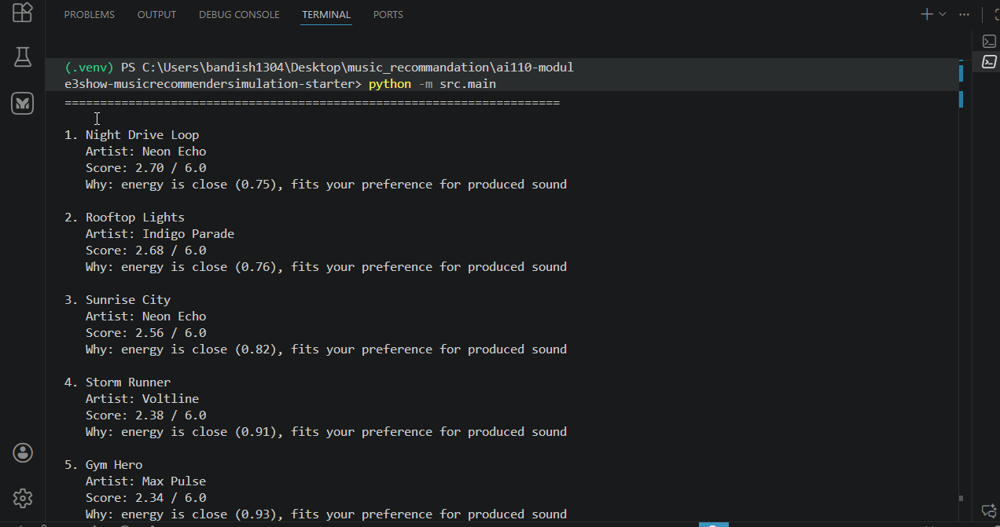

# 🎵 Music Recommender Simulation

## Project Summary

In this project you will build and explain a small music recommender system.

Your goal is to:

- Represent songs and a user "taste profile" as data
- Design a scoring rule that turns that data into recommendations
- Evaluate what your system gets right and wrong
- Reflect on how this mirrors real world AI recommenders

Replace this paragraph with your own summary of what your version does.

---

## How The System Works
Real-world recommendation systems usually mix many signals, like your listening history, behavior patterns, and what similar users liked, then rank choices by predicted fit. My version keeps that idea simple by prioritizing strong taste matches first, especially genre and mood, then adjusting with energy and acoustic preference so the recommendations still feel personal but easy to explain.

Some prompts to answer:

- What features does each `Song` use in your system
  - For example: genre, mood, energy, tempo
  - Answer: id, title, artist, genre, mood, energy, tempo_bpm, valence, danceability, acousticness
- What information does your `UserProfile` store
  - Answer: favorite_genre, favorite_mood, target_energy, likes_acoustic
- How does your `Recommender` compute a score for each song
  - Answer: Score each song using weighted rules: genre match +2.0, mood match +1.0, energy similarity up to +2.0, acoustic preference +1.0. Total max score is 6.0.
- How do you choose which songs to recommend
  - Answer: Sort all songs by their score descending and select the top k (default k=5).
- Expected biases: This system over-prioritizes genre; energy-focused users may miss great low-energy recommendations; acoustic preference might eliminate too many candidates; new genres never seen before will never be recommended.

You can include a simple diagram or bullet list if helpful.

**Algorithm Recipe (Finalized):**
- Genre match: +2.0 points
- Mood match: +1.0 point
- Energy similarity: +2.0 × (1 - |song.energy - user.target_energy|), clamped to [0, 2.0]
- Acoustic preference: +1.0 if alignment matches user preference
- Sort by total score descending, return top k

**Expected Biases:**
- This system over-prioritizes genre: a song matching favorite_genre will score well even if mood is mismatched
- Energy-focused users may miss great low-energy recommendations if their target_energy is high
- If the dataset is limited (only 10 songs), acoustic preference might eliminate too many candidates
- New or experimental genres not in the starter songs will never be recommended

---

## Getting Started

### Setup

1. Create a virtual environment (optional but recommended):

   ```bash
   python -m venv .venv
   source .venv/bin/activate      # Mac or Linux
   .venv\Scripts\activate         # Windows

2. Install dependencies

```bash
pip install -r requirements.txt
```

3. Run the app:

```bash
python -m src.main
```

### Terminal Output Screenshot

The screenshot below shows the CLI recommendation output including titles, scores, and reasons for all user profiles (including adversarial edge cases).




### Running Tests

Run the starter tests with:

```bash
pytest
```

You can add more tests in `tests/test_recommender.py`.

---

## Sample Recommendation Output

Paste a sample of your recommender's output here as a text block so a reader can see what it produces:

```
# e.g.:
# User profile: genre=indie, mood=chill, energy=low
# Recommendations:
#   1. ...
#   2. ...
#   3. ...
```

**Screenshot or video** *(optional)*: <!-- Insert a screenshot or demo video link here -->

---

## Experiments You Tried

Use this section to document the experiments you ran. For example:

- What happened when you changed the weight on genre from 2.0 to 0.5
- What happened when you added tempo or valence to the score
- How did your system behave for different types of users

---

## Limitations and Risks

Summarize some limitations of your recommender.

Examples:

- It only works on a tiny catalog
- It does not understand lyrics or language
- It might over favor one genre or mood

You will go deeper on this in your model card.

---

## Reflection

Read and complete `model_card.md`:

[**Model Card**](model_card.md)

Write 1 to 2 paragraphs here about what you learned:

- about how recommenders turn data into predictions
- about where bias or unfairness could show up in systems like this

My biggest learning moment was realizing that a recommender can be mathematically consistent but still feel wrong to a listener. The clearest example was the high-energy sad profile getting upbeat pop songs near the top. That happened because genre and energy matched strongly, even when the emotional mood did not. It showed me how a simple weighting decision can create recommendations that look valid by score but feel invalid to a real person.

Using AI tools helped me move faster when generating edge-case profiles, testing different weight settings, and drafting explanations, but I still had to verify everything in terminal output. Some suggestions sounded reasonable in theory but behaved differently when I actually ran the profiles. What surprised me most is that even a basic weighted algorithm can still feel like a real recommender when the inputs align well. If I continue this project, I would expand the dataset, add diversity rules to avoid repetitive top results, and replace hard thresholds like acoustic >= 0.5 with smoother similarity scoring.


