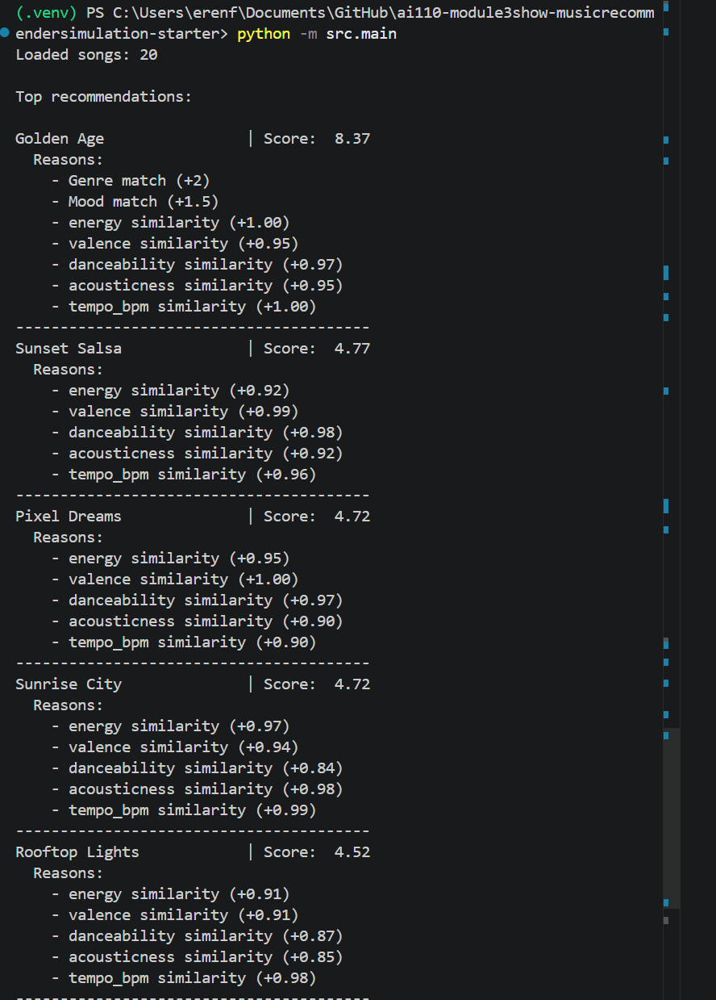

# 
# 

# 🎵 Music Recommender Simulation

## Project Summary

Recommendation engines, such as Spotify and YouTube, are tasked with predicting what users will choose on their platform to keep them engaged and retained. From what I've seen, these recommendation engines achieve their goals through Collaborative Filtering (learning from the preferences of similar users) and Content-Based Filtering (matching item features to user tastes). 

In my version, I will prioritize content-based filtering, which means matching songs to users based on features such as genre, mood, energy, and tempo.

---

## How The System Works

Each `Song` in my system is described by features such as genre, mood, energy, tempo (bpm), valence, danceability, and acousticness. These features capture both the style and the "vibe" of the music.

The `UserProfile` stores the user's preferred values for these features. For instance, their favorite genre, desired mood, and ideal levels for energy, tempo, and other attributes. This profile represents what the user is most likely to enjoy.

The `Recommender` computes a score for each song by comparing the song's features to the user's preferences. For numerical features (like energy or tempo), it rewards songs that are closer to the user's preferred value. For categorical features (like genre or mood), it gives a higher score to exact matches. All feature scores are combined—often as a weighted sum—to produce an overall match score for each song.

To choose which songs to recommend, the system ranks all songs by their match scores and selects the top results. This ensures that the recommendations are the songs most closely aligned with the user's unique taste profile.

flowchart TD
    A[Input: User Preferences] --> B[Process: For each song in CSV<br>Apply scoring logic]
    B --> C[Output: Top K Recommendations]
---

## Getting Started

### Setup

1. Create a virtual environment (optional but recommended):

   ```bash
   python -m venv .venv
   source .venv/bin/activate      # Mac or Linux
   .venv\Scripts\activate         # Windows

2. Install dependencies

```bash
pip install -r requirements.txt
```

3. Run the app:

```bash
python -m src.main
```

### Running Tests

Run the starter tests with:

```bash
pytest
```

You can add more tests in `tests/test_recommender.py`.

---

## Experiments You Tried

- I experimented with changing the weight of the genre feature from 2.0 to 1.0, and doubled the weight of the energy feature. This made the system more sensitive to energy preferences and less dominated by genre, resulting in more energetic songs appearing at the top for high-energy users, even if the genre was not a perfect match.

- I tested the system with both typical and adversarial user profiles, including users with conflicting or extreme preferences. This helped reveal how the recommender handles edge cases and whether it can be "tricked" by unusual input.

- I observed how removing or commenting out the mood feature affected the diversity and relevance of recommendations, and found that mood plays a significant role in aligning results with user expectations.

- I also tried adjusting the weights for other features, such as danceability and acousticness, to see how the top recommendations changed for different user types.

---

## Limitations and Risks

- The system only works on a small catalog of 20 songs, which limits the diversity and accuracy of recommendations.

- Some genres and moods are underrepresented in the dataset, which can bias the results toward more common categories.

- The recommender does not consider lyrics, language, or user listening history, so it may miss important aspects of musical taste.

- Changing feature weights can cause the system to over-prioritize a single attribute, reducing the overall quality and diversity of recommendations.

- Users with niche or conflicting preferences may not receive recommendations that feel accurate or personalized.

You will go deeper on this in your model card.

---

## Reflection

Through this project, I learned how recommender systems use both categorical and numerical features to predict what users might enjoy. I saw firsthand how the choice of features and their weights can dramatically affect the recommendations, sometimes in unexpected ways. Testing with a variety of user profiles—including edge cases—helped me understand the importance of balancing different aspects of user taste.

I also realized how easily bias can creep into a system, especially when the dataset is small or unbalanced. This experience made me appreciate the challenges of building fair and useful recommendation engines, and the need for careful evaluation and iteration. Overall, this project deepened my understanding of how data-driven systems can both reflect and amplify the limitations of their underlying data and design choices.

---

## 7. `model_card_template.md`

Combines reflection and model card framing from the Module 3 guidance. :contentReference[oaicite:2]{index=2}  

```markdown
# 🎧 Model Card - Music Recommender Simulation

## 1. Model Name

**VibeFinder 1.0**

---

## 2. Intended Use

This model suggests 3 to 5 songs from a small catalog based on a user's preferred genre, mood, and energy level. It is designed for classroom exploration and learning about recommender systems, not for real-world deployment. The system assumes users can describe their preferences numerically and by category, and helps students see how different features and weights affect recommendations.

---

## 3. How It Works (Short Explanation)

The recommender compares each song's features—such as genre, mood, energy, tempo, valence, danceability, and acousticness—to the user's stated preferences. Genre and mood matches add fixed points, while numerical features add points based on how close the song is to the user's target. All these scores are combined, and the top-scoring songs are recommended. The system is transparent and easy to adjust, making it ideal for experimentation and learning.

---

## 4. Data

The dataset contains 20 songs, each with attributes for genre, mood, and several audio features. Genres include pop, lofi, rock, ambient, jazz, synthwave, indie pop, world, chip tune, blues, folk, trap, disco, classical, latin, drum and bass, and metal. Moods range from happy and chill to intense, relaxed, and reflective. No data was added or removed from the starter set. The data mostly reflects a broad but limited sample of musical styles, not any one person's taste.

---

## 5. Strengths

The recommender works well for users with clear, mainstream preferences, such as those who like high-energy pop or chill lofi. It captures patterns like matching genre and mood, and rewards songs that closely fit a user's desired energy or danceability. In many cases, the top recommendations align with musical intuition, especially when the user's preferences are well-represented in the dataset. The scoring system is simple, transparent, and easy to modify for experimentation.

---

## 6. Limitations and Bias

The system can over-prioritize songs with high energy, especially after increasing the weight for energy similarity. This sometimes causes songs with only a loose genre or mood match to appear at the top, reducing diversity. The small dataset means some genres or moods are underrepresented, which can bias results toward more common categories. The recommender treats all users as if they have the same "taste shape" and does not account for more complex or evolving preferences. If used in a real product, these limitations could lead to unfair or repetitive recommendations.

---

## 7. Evaluation

I tested the recommender using both typical and adversarial user profiles. For each profile, I checked whether the top 5 recommendations made sense given the user's stated preferences. I looked for cases where the system was "tricked" by conflicting or extreme preferences, and compared the results to my own musical intuition. I also experimented with changing feature weights to see how the rankings shifted. This process revealed both strengths and weaknesses in the scoring logic.

---

## 8. Future Work

With more time, I would expand the dataset to include more songs and genres, and add support for multiple users or group recommendations. I would also work on balancing diversity among the top results, so the system doesn't always pick the closest match. Adding more features, such as tempo ranges, lyric themes, or user listening history, could make the recommendations more accurate and personalized.

---

## 9. Personal Reflection

I was surprised by how much a single feature weight could affect the top results, and how easily the system could be biased by the dataset. Building this recommender helped me understand the importance of balancing different aspects of user taste and the challenges of making fair, useful recommendations. Even with a "smart" model, human judgment is still needed to interpret results and ensure the system serves all users well.
```

