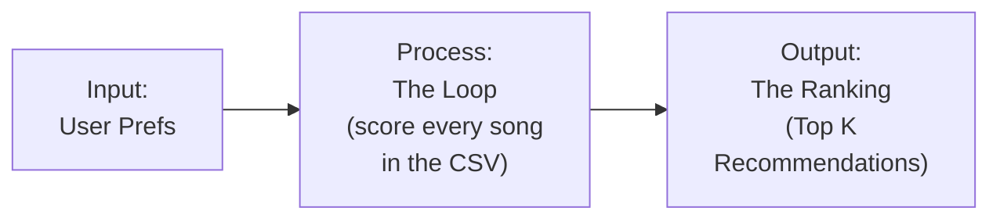

# 🎵 Music Recommender Simulation

## Project Summary

In this project you will build and explain a small music recommender system.

Your goal is to:

- Represent songs and a user "taste profile" as data
- Design a scoring rule that turns that data into recommendations
- Evaluate what your system gets right and wrong
- Reflect on how this mirrors real world AI recommenders

Replace this paragraph with your own summary of what your version does.

---

## How The System Works

Real-world recommenders like Spotify or YouTube blend several signals: collaborative filtering (what similar users liked), content-based filtering (audio/text features of the item itself), and behavioral signals (skips, replays, watch time) fed through models that get retrained continuously. This simulation is a simplified, transparent version of the content-based slice of that pipeline: instead of learning weights from millions of listening sessions, it uses a small, hand-picked set of song attributes and a fixed, explainable scoring rule to match songs to a single stated user profile. The priority here isn't predictive accuracy at scale — it's making the scoring logic legible, so every recommendation can be traced back to the exact rule that produced it.

**`Song` features used:**
- `genre` — categorical, exact-match against the user's favorite genre
- `mood` — categorical, exact-match against the user's favorite mood
- `energy` — continuous (0–1), compared for closeness to the user's target energy
- `acousticness` — continuous (0–1), checked against the user's acoustic preference

**`UserProfile` fields used:**
- `favorite_genre` — genre the user is scored against
- `favorite_mood` — mood the user is scored against
- `target_energy` — desired energy level (0–1)
- `likes_acoustic` — boolean preference for acoustic vs. produced sound

**How `Recommender` computes a score:**
Each song earns points independently: +3 for a genre match, +2 for a mood match, up to +2 scaled by how close the song's energy is to the user's target energy, and +1 if the song's acousticness aligns with the user's `likes_acoustic` preference. These are summed into a single score per song, and each rule that fires is logged as a plain-language "reason" for `explain_recommendation`.

**How songs are chosen:**
Every song in the catalog is scored independently (scoring rule), then all scores are sorted descending and the top `k` are returned (ranking rule) — keeping "how good is this match" and "which ones do we show" as separate steps.

**Data flow:**



**Algorithm Recipe (finalized):**

| Rule | Condition | Points |
|---|---|---|
| Genre match | `song.genre == user.favorite_genre` | +3 |
| Mood match | `song.mood == user.favorite_mood` | +2 |
| Energy closeness | `2 * (1 - abs(song.energy - user.target_energy))` | up to +2 |
| Acousticness preference | matches `likes_acoustic` (acoustic-leaning if True, produced-leaning if False) | +1 |

Total score = sum of the above (max ≈ 8). All songs are scored independently, then sorted descending and truncated to the top `k`.

**Potential biases:**
- **Genre dominance:** genre is weighted highest (+3), so a song that's a strong mood and energy match but the "wrong" genre can be outranked by a mediocre song that merely shares the genre label — the system might over-prioritize genre and miss great songs that fit the user's mood or energy better.
- **Exact-match brittleness:** genre and mood use exact string matching, not similarity — a user who likes "indie pop" gets zero credit for a near-identical "pop" or "indie" song, even though a human would consider them close.
- **Small, hand-labeled catalog:** with only 18 songs and subjective mood/genre labels, the system's "taste" is really just whoever tagged the CSV — it can't generalize to songs or genres outside this dataset, and mislabeled or ambiguous songs will be scored on the wrong basis entirely.
- **No personalization over time:** the profile is static (one fixed `UserProfile`), so the system can't learn from skips, replays, or feedback — unlike real recommenders, it has no way to correct a bad initial guess about the user's taste.

---

## Getting Started

### Setup

1. Create a virtual environment (optional but recommended):

   ```bash
   python -m venv .venv
   source .venv/bin/activate      # Mac or Linux
   .venv\Scripts\activate         # Windows

2. Install dependencies

```bash
pip install -r requirements.txt
```

3. Run the app:

```bash
python -m src.main
```

### Running Tests

Run the starter tests with:

```bash
pytest
```

You can add more tests in `tests/test_recommender.py`.

---

## Sample Recommendation Output

User profile: `genre=lofi, mood=chill, energy=0.35, likes_acoustic=True`

```
==================================================
Top 5 Recommendations
==================================================

1. Library Rain  (Score: 8.00)
   Because: matches favorite genre 'lofi', matches favorite mood 'chill', energy 0.35 close to target 0.35, acoustic sound matches your preference

2. Midnight Coding  (Score: 7.86)
   Because: matches favorite genre 'lofi', matches favorite mood 'chill', energy 0.42 close to target 0.35, acoustic sound matches your preference

3. Focus Flow  (Score: 5.90)
   Because: matches favorite genre 'lofi', energy 0.40 close to target 0.35, acoustic sound matches your preference

4. Spacewalk Thoughts  (Score: 4.86)
   Because: matches favorite mood 'chill', energy 0.28 close to target 0.35, acoustic sound matches your preference

5. Coffee Shop Stories  (Score: 2.96)
   Because: energy 0.37 close to target 0.35, acoustic sound matches your preference
```

**Screenshot or video** *(optional)*: <!-- Insert a screenshot or demo video link here -->

---

## Edge Case Profiles

Adversarial/edge-case user profiles designed to stress-test the scoring logic — conflicting preferences, unknown values, and missing data — to see whether the additive scoring rule breaks or produces misleading results.

**1. Conflicting energy/mood** — `{"genre": "rock", "mood": "moody", "energy": 0.95, "likes_acoustic": False}`

```
1. Storm Runner  (Score: 5.92)
   Because: matches favorite genre 'rock', energy 0.91 close to target 0.95, produced sound matches your preference
2. Night Drive Loop  (Score: 4.60)
   Because: matches favorite mood 'moody', energy 0.75 close to target 0.95, produced sound matches your preference
3. Gym Hero  (Score: 2.96)
   Because: energy 0.93 close to target 0.95, produced sound matches your preference
4. Iron Fury  (Score: 2.96)
   Because: energy 0.97 close to target 0.95, produced sound matches your preference
5. Block Party Anthem  (Score: 2.84)
   Because: energy 0.87 close to target 0.95, produced sound matches your preference
```
No song in the catalog is simultaneously "moody" and 0.95 energy, so the top result satisfies genre + energy but not mood — the system has no way to flag that the request itself is contradictory.

**2. Nonexistent genre** — `{"genre": "dubstep", "mood": "chill", "energy": 0.4, "likes_acoustic": True}`

```
1. Midnight Coding  (Score: 4.96)
   Because: matches favorite mood 'chill', energy 0.42 close to target 0.40, acoustic sound matches your preference
2. Library Rain  (Score: 4.90)
   Because: matches favorite mood 'chill', energy 0.35 close to target 0.40, acoustic sound matches your preference
3. Spacewalk Thoughts  (Score: 4.76)
   Because: matches favorite mood 'chill', energy 0.28 close to target 0.40, acoustic sound matches your preference
4. Focus Flow  (Score: 3.00)
   Because: energy 0.40 close to target 0.40, acoustic sound matches your preference
5. Coffee Shop Stories  (Score: 2.94)
   Because: energy 0.37 close to target 0.40, acoustic sound matches your preference
```
Genre match never fires (max possible score drops from 8 to 5), but the system degrades gracefully — it just ranks on mood/energy/acousticness instead of erroring out.

**3. Contradictory acousticness** — `{"genre": "metal", "mood": "angry", "energy": 0.97, "likes_acoustic": True}`

```
1. Iron Fury  (Score: 7.00)
   Because: matches favorite genre 'metal', matches favorite mood 'angry', energy 0.97 close to target 0.97
2. Gym Hero  (Score: 1.92)
   Because: energy 0.93 close to target 0.97
3. Midnight Coding  (Score: 1.90)
   Because: energy 0.42 close to target 0.97, acoustic sound matches your preference
4. Storm Runner  (Score: 1.88)
   Because: energy 0.91 close to target 0.97
5. Focus Flow  (Score: 1.86)
   Because: energy 0.40 close to target 0.97, acoustic sound matches your preference
```
The top result (Iron Fury) wins on genre + mood + energy alone and never earns the acousticness point — a structurally impossible combination (acoustic metal at 0.97 energy) is quietly ignored rather than flagged.

**4. Empty/missing preferences** — `{"genre": "", "mood": "", "energy": None, "likes_acoustic": None}`

```
1. Sunrise City  (Score: 0.00)
   Because: 
2. Midnight Coding  (Score: 0.00)
   Because: 
3. Storm Runner  (Score: 0.00)
   Because: 
4. Library Rain  (Score: 0.00)
   Because: 
5. Gym Hero  (Score: 0.00)
   Because: 
```
Confirms `score_song` doesn't crash on missing preferences — every rule short-circuits and all songs tie at 0.00. But this exposes a ranking weakness: with no differentiating signal, the "top 5" is really just the first 5 rows of the CSV in original order (a stable sort artifact), which could look deceptively like a real recommendation.

**5. Neutral energy extreme (0.5)** — `{"genre": "jazz", "mood": "relaxed", "energy": 0.5, "likes_acoustic": None}`

```
1. Coffee Shop Stories  (Score: 6.74)
   Because: matches favorite genre 'jazz', matches favorite mood 'relaxed', energy 0.37 close to target 0.50
2. Velvet Whisper  (Score: 1.96)
   Because: energy 0.48 close to target 0.50
3. Dusty Highway  (Score: 1.90)
   Because: energy 0.55 close to target 0.50
4. Midnight Coding  (Score: 1.84)
   Because: energy 0.42 close to target 0.50
5. Focus Flow  (Score: 1.80)
   Because: energy 0.40 close to target 0.50
```
Below the clear #1 match, results 2-5 are near-ties (1.80-1.96) driven entirely by energy closeness — with only one real jazz/relaxed song in the catalog, the rest of the list is filler that happens to sit near 0.5 energy, not genuine taste matches.

**6. Genre-mood mismatch** — `{"genre": "ambient", "mood": "intense", "energy": 0.3, "likes_acoustic": False}`

```
1. Spacewalk Thoughts  (Score: 4.96)
   Because: matches favorite genre 'ambient', energy 0.28 close to target 0.30
2. Storm Runner  (Score: 3.78)
   Because: matches favorite mood 'intense', energy 0.91 close to target 0.30, produced sound matches your preference
3. Gym Hero  (Score: 3.74)
   Because: matches favorite mood 'intense', energy 0.93 close to target 0.30, produced sound matches your preference
4. Night Drive Loop  (Score: 2.10)
   Because: energy 0.75 close to target 0.30, produced sound matches your preference
5. Rooftop Lights  (Score: 2.08)
   Because: energy 0.76 close to target 0.30, produced sound matches your preference
```
Directly confirms the genre-dominance bias noted earlier: an ambient song that completely misses the "intense" mood still outranks two genuinely intense, high-energy songs, purely because genre is weighted higher (+3) than mood (+2).

---

## Experiments You Tried

Use this section to document the experiments you ran. For example:

- What happened when you changed the weight on genre from 2.0 to 0.5
- What happened when you added tempo or valence to the score
- How did your system behave for different types of users

---

## Limitations and Risks

Summarize some limitations of your recommender.

Examples:

- It only works on a tiny catalog
- It does not understand lyrics or language
- It might over favor one genre or mood

You will go deeper on this in your model card.

---

## Reflection

Read and complete `model_card.md`:

[**Model Card**](model_card.md)

Write 1 to 2 paragraphs here about what you learned:

- about how recommenders turn data into predictions
- about where bias or unfairness could show up in systems like this


